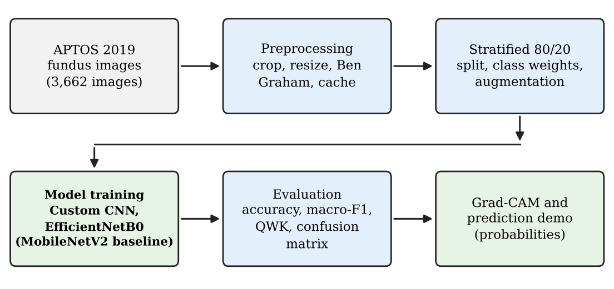
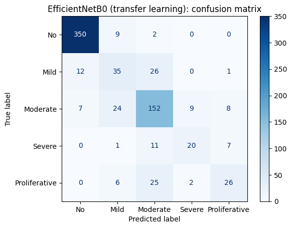
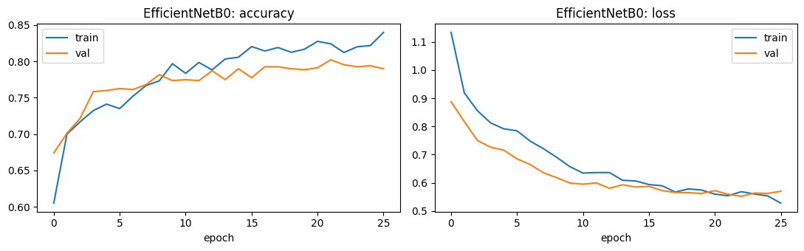
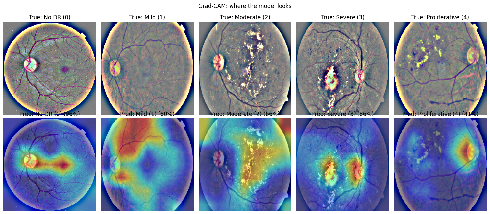
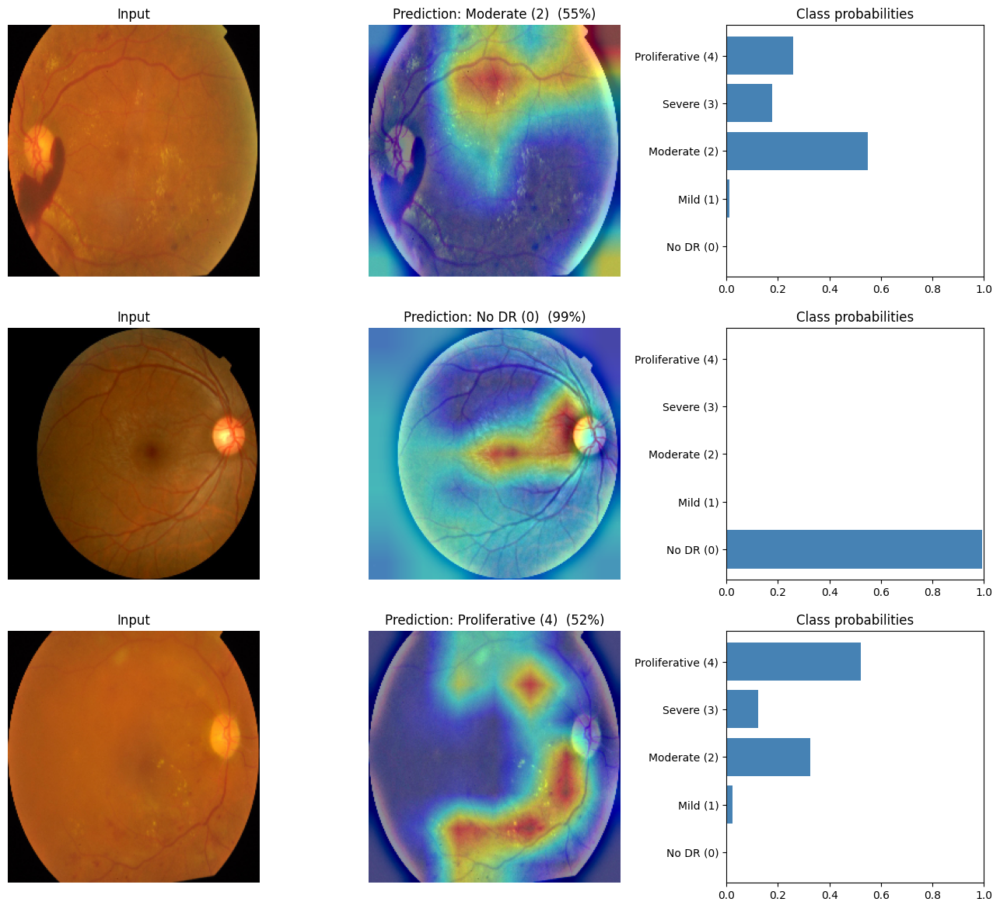

# Diabetic Retinopathy Detection (APTOS 2019)

Deep Learning course project, B.Tech CSE (Artificial Intelligence), Adi Shankara Institute of Engineering and Technology, Kalady.

**Team:** Anwar M R (ASI23CA015), Arjun Suresh (ASI23CA017)  
**Guide:** Prof. Asha Rose Thomas

Five-grade classification of retinal fundus images (0 No DR, 1 Mild, 2 Moderate, 3 Severe, 4 Proliferative DR) using a custom CNN and transfer learning (EfficientNetB0) on the [APTOS 2019 Blindness Detection](https://www.kaggle.com/c/aptos2019-blindness-detection) dataset (3,662 labelled images). Early detection of DR helps prevent blindness.

> Educational prototype. This is **not** a medical diagnostic tool.

## What the notebook does
- Downloads the dataset with the Kaggle API (the token is typed at run time and never stored).
- Preprocessing: black-border crop, resize to 224x224, Ben Graham enhancement, cached once so epochs take seconds.
- Stratified 80/20 split, square-root balanced class weights, augmentation.
- Trains a custom CNN and a two-stage fine-tuned EfficientNetB0 (frozen head, then last 80 layers unfrozen).
- Evaluates with accuracy, macro-F1, quadratic weighted kappa (QWK) and confusion matrices.
- Grad-CAM heatmaps and a `predict_fundus(path)` single-image demo.

## Results (validation split, 733 images)

| Model | Pipeline | Accuracy | Macro-F1 | QWK |
|---|---|---|---|---|
| Custom CNN | Original | 0.5471 | 0.2585 | n/a |
| MobileNetV2 | Original | 0.6671 | 0.5031 | n/a |
| Custom CNN | Improved | 0.6562 | 0.3099 | 0.6507 |
| **EfficientNetB0** | Improved | **0.7954** | **0.6492** | **0.8560** |

The "Original" rows are from our first experiments without retina-specific preprocessing, so the EfficientNetB0 gain over MobileNetV2 combines the stronger backbone and the improved pipeline.

EfficientNetB0 per class (precision / recall / F1): No DR 0.95/0.97/0.96, Mild 0.47/0.47/0.47, Moderate 0.70/0.76/0.73, Severe 0.65/0.51/0.57, Proliferative 0.62/0.44/0.51. About 67% of its errors are off by one grade only.

| Confusion matrix | Training curves |
|---|---|
|  |  |

## How to run
1. Open `Diabetic_Retinopathy_Detection.ipynb` in Google Colab.
2. Runtime > Change runtime type > GPU (T4).
3. Run all cells and paste your Kaggle API token when asked. Total time is roughly 15-30 minutes on a T4.

## Limitations
Class imbalance (severe cases are 5.3% of the data), confusion between neighbouring grades, a single dataset and a single validation split, and 224x224 input resolution. Results may not carry over to other cameras or hospitals.
